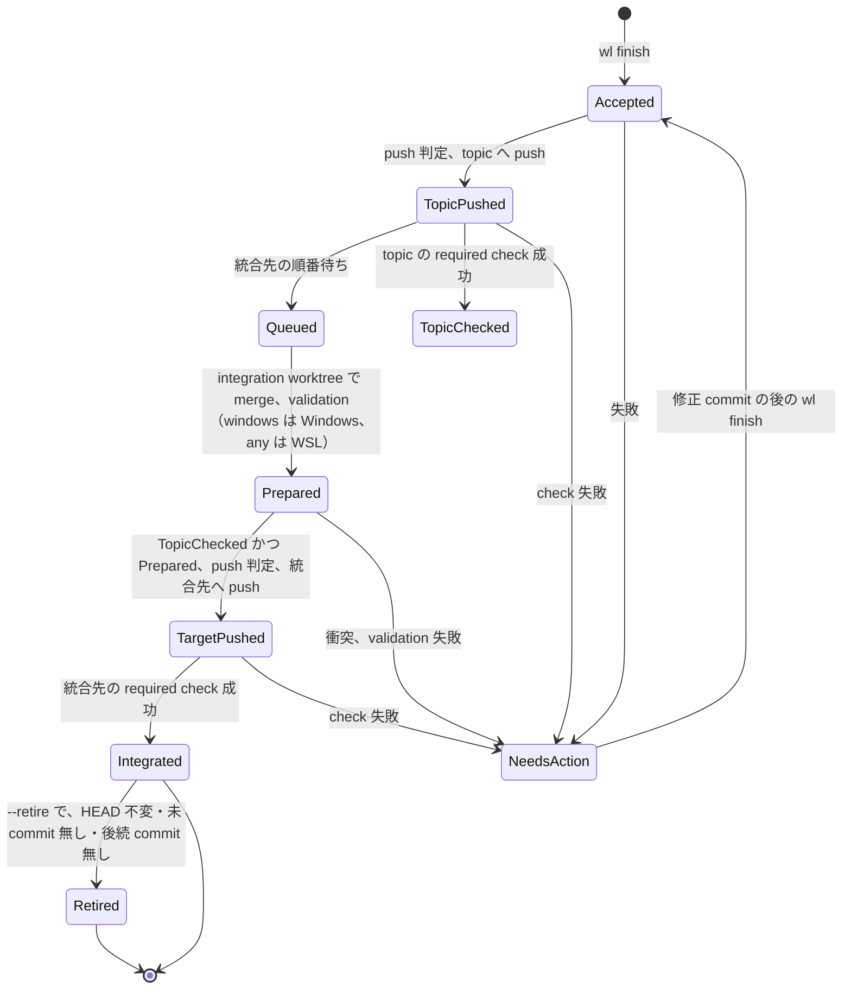

# 設計

Windows で開発 session を動かす人と agent が、task の開始から統合・退役までを、道具の処理を待たずに進めるための設計。用語は `CONTEXT.md`、各判断の理由は `docs/adr/` にある。

## 基準

- `status`、`begin`、`finish` の受付、`hold` の command latency は、Windows controller の実測で p90 50 ms 以下（ADR 0008）。
- validation、required check、統合、退役は background work で、呼び手を待たせない（ADR 0006）。
- 人が環境間の environment handoff を要求されることは無い（ADR 0001）。

## 構成

| 部品 | 場所 | 役目 |
|---|---|---|
| `wl.exe` | Windows | 全 command。Rust の単一実行 file（ADR 0002） |
| worker | Windows | `wl.exe` が finish acceptance ごとに起動する、切り離された process（ADR 0006） |
| offload 実行先 | WSL の `ubuntu-26-development` | offload 専用の user と directory。`any` の validation 手順を走らせる（ADR 0014） |
| push 判定 | 既存の `workspace_lifecycle.push` | worker が push の前に呼ぶ（ADR 0012） |

Git の読取りは gix でプロセス内から行い、読む設定は必要な file に限る。git CLI は push、merge、branch の切替だけに使う。

## データ

すべて repository の Git 共通 dir の `wl/` の下に置く。一つの file に書く主体は常に一つで、更新は一時 file への書込みと rename で行う（ADR 0009）。

| file | 書く主体 | 内容 |
|---|---|---|
| `tasks/<task>.json` | その task の command と worker | task、slot、確定した commit、finish の段階、needs-action の理由、通知済みの印 |
| `slots/<n>.json` | begin と退役 | slot の path、割当て先の task または空き |
| `queue/<target>/<受付時刻>-<task>` | finish acceptance が作り、worker が消す | 統合先ごとの受付順 |
| `workers/<task>.lock` | worker | OS の file lock。worker が落ちると lock も外れる |

repository が管理する宣言は `.lifecycle.toml` に置く。validation の手順と各手順の offload declaration（ADR 0007、0010）、required check、slot cache の path（ADR 0015）である。worker は確定した commit に含まれる版を読む。

## command

| command | 前景で行うこと | 想定の費用 |
|---|---|---|
| `wl begin <task>` | 空いている slot を選び、base から topic branch を作って切り替える。空きが無いときだけ新しい slot を作る | 差分の書込みだけ。新しい slot は 0.3〜0.5 s（推定、まれ） |
| `wl status` | task の state file と未読の通知を読む | 数 ms |
| `wl finish [--retire]` | HEAD を確定した commit として記録し、受付順の file を作り、worker を起動して戻る | 数 ms と process の起動 |
| `wl hold` / `wl release-hold` | state file を書き換える | 数 ms |
| `wl retire` | 明示の退役。slot を空きに戻す | 差分の書込み |

どの command も起動時に、lock の外れた worker を持つ未完了の finish を探す。見つかれば worker を起動し直してから本来の処理を行う。直前の command 以後の結果も先頭に出す。

## finish の段階

- topic の required check と、統合先での merge と validation は並行に進む。
- 統合先が先行の統合で進んだら、merge commit を作り直して validation をやり直す（ADR 0011）。
- needs-action では、integration worktree を準備前に戻し、理由を記録して worker を終える。remote の統合先は push の前なので変わらない。
- 結果は、次の command の先頭と `wl status` に出す。needs-action のときは Windows のトースト通知も出す（ADR 0006）。

## WSL offload

1. worker は、確定した commit または merge commit を `git archive` で書き出し、`wsl.exe -d ubuntu-26-development -u <offload user>` で WSL 内の offload slot へ展開する。
2. offload slot は repository ごとに path が固定されているので、cargo の build-dir はそのまま再利用される。
3. 宣言された command を実行し、終了 code と log を Windows 側の state に戻す。

`/mnt/c` を経由する読み書きはしない。offload する手順は commit の内容だけを入力にする。

## slot

- `begin` は空いている slot を割り当てる。
- 退役は、宣言された slot cache を除く ignored data と未追跡 file を消してから、slot を base の HEAD に戻して空きにする。commit されていない内容があるときは、消す前に recovery copy を作る（ADR 0005）。
- 空きの slot は、worker が background で最新の base へ進めておく。

## 移行

- 切替の前に始めた task は legacy lifecycle で完了させる（ADR 0003）。
- 最初に切り替えるのは funkot-player と funkot-autodj-for-ui（ADR 0008）。agent が使う入口は、agent-rules の規則で repository ごとに `wl` へ切り替える。
- 受入は 2 つの観点で行う。
  - controller で各 command の p90 を実測し、50 ms 以下であることを確かめる。
  - funkot の実 task 1 件で、begin から統合、退役まで、人が道具を待たずに完了することを確かめる。

## 初版で作らないもの

- needs-action のときに Issue へコメントする option（ADR 0006）
- 複数の finish をまとめて統合する merge train（ADR 0011）
- push 判定の Rust への移植（ADR 0012）
