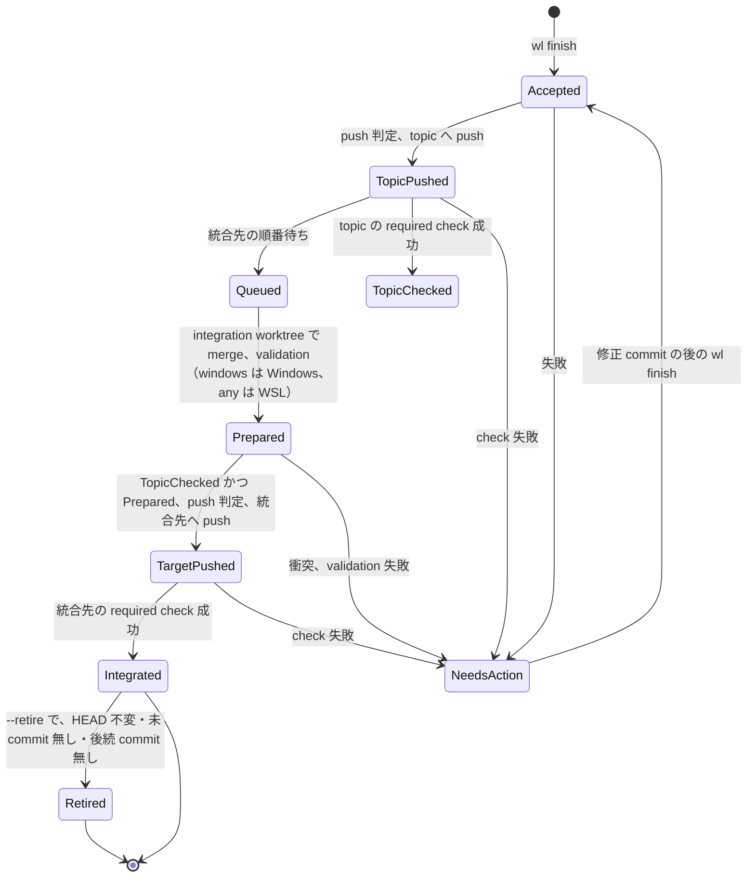

# 設計

Windows で開発 session を動かす人と agent が、task の開始から統合・退役までを、道具の処理を待たずに進めるための設計。用語は `CONTEXT.md`、各判断の理由は `docs/adr/` にある。

## 基準

- `status`、`begin`、`finish` の受付、`hold` の command latency は、Windows controller の実測で p90 50 ms 以下（ADR 0008）。
- validation、required check、統合、退役は background work で、呼び手を待たせない（ADR 0006）。
- 人が環境間の environment handoff を要求されることは無い（ADR 0001）。

## 構成

| 部品 | 場所 | 役目 |
|---|---|---|
| `wl.exe` | Windows | 全 command。Rust の単一実行 file（ADR 0002） |
| worker | Windows | `wl.exe` が finish acceptance ごとに起動する、切り離された process（ADR 0006） |
| offload 実行先 | WSL の `Ubuntu-26.04` | offload 専用の user と directory。`any` の validation 手順を走らせる（ADR 0014） |
| push 判定 | 既存の `workspace_lifecycle.push` | worker が push の前に呼ぶ（ADR 0012） |

Git の読取りは gix でプロセス内から行う。設定は system、application、user の file を includes つきで読み、環境変数からの設定は読まない。Windows では gix が system の設定と attributes の場所を知るために git を起動するので、`wl` は Git の root を user ごとに `%LOCALAPPDATA%\wl\git-root` へ cache し、`EXEPATH` に入れてから開く。Git Bash は `EXEPATH` に Git の `bin` の path を入れるが、これは root ではないので、cache の root で置き換える。`wl` が起動する他の program には、呼び手の `EXEPATH` を渡す。git CLI は、push、merge、fetch、slot と integration worktree の作成・checkout・clean、未追跡の file を含む変更の確認だけに使う。ref の解決と祖先の判定は、background work でも gix で行う。Windows では、background work が process を起動している間、前景の command の起動も遅くなるからである。同じ理由で、required check の状態は GitHub API を process 内の HTTP で読む。`gh` は待ちごとに一度、token を得るためにだけ起動する。

1 回の `finish --retire`（fast-forward、validation と required check なし）で worker と退役が起動する git は、11 回である。以前は 22 回だった。check の待ちで、15 秒ごとに `gh` を起動することもなくなった。

切り離した process は、Windows では標準 handle を継承させず、優先度を通常より低くして起動する。継承させると、呼び手が `wl` の出力の終わりを待つ間、background work の終了まで待たされる。

## データ

すべて repository の Git 共通 dir の `wl/` の下に置く。一つの file に書く主体は常に一つで、更新は一時 file への書込みと rename で行う（ADR 0009）。新規作成は hard link で行い、既にあれば失敗する。前景の command の書込みは disk へ flush しない。crash で失われた書込みは、同じ command をもう一度実行すれば作り直される。

| file | 書く主体 | 内容 |
|---|---|---|
| `tasks/<task>.json` | begin と退役 | task、slot、branch、base |
| `holds/<task>.json` | hold と release-hold | hold の理由 |
| `finishes/<task>/accept.json` | `wl finish` | 試行の番号と実行 `id`、確定した commit、統合先、`--retire` |
| `finishes/<task>/progress.json` | その task の worker | 試行の段階、merge commit、統合を始めた統合先の commit、needs-action の理由、worker の開始時に未 commit の変更や未追跡の file があったか |
| `runs/<id>.json` | `wl finish` とその task の worker | 実行ごとの finish の状態と結果。退役後も残る |
| `notices/<task>-<試行>-<段階>.json` | worker が作り、表示した command が消す | 統合、退役、needs-action の知らせ（実行 `id` を含む） |
| `slots/<n>.json` | begin と退役 | slot の path、割当て先の task または空き |
| `queue/<target>/<受付時刻>-<task>` | finish acceptance が作り、worker が消す | 統合先ごとの受付順 |
| `workers/<task>.lock` | worker | OS の file lock。worker が落ちると lock も外れる |

repository が管理する宣言は `.lifecycle.toml` に置く。validation の手順と各手順の offload declaration（ADR 0007、0010）、slot cache の path（ADR 0015）である。required check は、legacy lifecycle と同じ `.github/required-checks.json` を読む。worker はどちらも確定した commit に含まれる版を読む。

push preflight の argv は private policy の path を含むので repository に置かず、user ごとの設定 file（Windows は `%LOCALAPPDATA%\wl\config.json`、`WL_CONFIG` で上書き）に `{"preflight": [..., "{repo}", ...]}` として置く。

## command

| command | 前景で行うこと | 想定の費用 |
|---|---|---|
| `wl begin <task> [--target <branch>]` | 空いている slot を選び、base から topic branch を作って切り替える。base は fetch せず、最後に fetch した `origin/HEAD`（`--target` があれば `origin/<branch>`）を使う。`--target` の branch が、その task の統合先になる。空きの slot が base にあれば ref を動かすだけで、file は書かない。空きが無くなったら、次の slot の準備を background で始める | runner で p90 46〜48 ms。空きが無いときだけ 0.3〜0.5 s（推定、まれ） |
| `wl status [TASK] [--finish ID]` | task の state file と未読の通知を読む。`--finish ID` を指定すると退役後もその実行の結果を返す | runner で p90 12〜17 ms |
| `wl finish [--retire]` | HEAD を確定した commit として記録し、実行 `id` と受付順の file を作り、worker を起動して戻る。checkout に未 commit の変更や未追跡の file があるかは、Windows で約 20 ms かかるので worker が調べ、統合の知らせに添える | 数 ms と process の起動 |
| `wl hold` / `wl release-hold` | state file を書き換える | 数 ms |
| `wl retire` | 明示の退役。slot を空きに戻す | 差分の書込み |

どの command も起動時に、lock の外れた worker を持つ未完了の finish を探す。見つかれば worker を起動し直してから本来の処理を行う。直前の command 以後の結果も先頭に出す。

## finish の段階

- topic へ push するのは、受付で確定した commit である。push preflight は task の branch がある slot で実行し、その判定した宛先へ push する。受付の後に積まれた commit は次の finish の対象になる。
- 統合先への push は、upstream を統合先にした branch `wl-integrate-<統合先>` を持つ integration worktree から行う。push preflight はこの upstream から宛先を統合先と判定し、default branch の policy を適用する。
- 統合先ごとの順番は、受付順の file で決まる。順番を持つのは merge の準備から統合先への push までで、統合先の required check を待つ間は次の task に譲る。
- topic の required check と、統合先での merge と validation は並行に進む。確定した commit が統合先に含まれていれば、validation はしない。
- 統合先が先行の統合で進んだら、merge commit を作り直して validation をやり直す（ADR 0011）。
- needs-action では、integration worktree を準備前に戻し、理由を記録して worker を終える。remote の統合先は push の前なので変わらない。
- 結果は、次の command の先頭と `wl status` に出す。needs-action のときは Windows のトースト通知も出す（ADR 0006）。

## WSL offload

user ごとの設定 file の `offload` に、WSL で command を実行する前置き（例 `["wsl.exe", "-d", "Ubuntu-26.04", "-u", "wl-offload", "-e"]`）と、WSL 内の root を書く。前置きの最後は `-e` にする。`--` では、wsl.exe が command line を distro の shell にもう一度解釈させ、`sh -c` に渡す引数が失われる。設定が無ければ、`any` の手順も Windows で走る。

1. worker は、merge 済みの commit を `git archive` で書き出し、前置きを通して WSL 内の `<root>/<repository>-<統合先>` へ展開する。展開の前に、前の内容は消す。
2. 展開は `tar -m` で行い、file の時刻を展開した時刻にする。archive の時刻は commit の時刻で、前回の build より古いので、cargo は変わった source を新しくないと判断してしまう。
3. 展開先は毎回消すので、`target/` に build を残せない。offload user の cargo 設定で build-dir を展開先の外（例 `~/.cache/cargo-build/{workspace-path-hash}`）に置く。展開先の path は repository と統合先ごとに固定なので、前回の build を再利用する。
4. 宣言された command をその directory で実行し、出力は Windows 側の log に残す。

`/mnt/c` を経由する読み書きはしない。offload する手順は commit の内容だけを入力にする。

## slot

- `begin` は空いている slot を割り当てる。
- 退役は、commit されていない変更、未追跡の file、統合先に無い commit のどれかがあれば拒否する。拒否しなければ、宣言された slot cache を除く ignored data を消し、branch を消して slot を空きにする。失うものが無いときだけ退役するので、recovery copy は作らない。
- 空きの slot は、background の準備が `origin` を fetch したうえで最新の base へ進めておく。準備の最後に、1 秒ほど置いてから index を更新する。checkout 直後の index は全 file を「racy」として扱い、次の変更確認が全 file の内容を読むからである。

## 移行

- 切替の前に始めた task は legacy lifecycle で完了させる（ADR 0003）。
- 最初に切り替えるのは funkot-player と funkot-autodj-for-ui（ADR 0008）。agent が使う入口は、agent-rules の規則で repository ごとに `wl` へ切り替える。
- 受入は 2 つの観点で行う。
  - controller で各 command の p90 を実測し、50 ms 以下であることを確かめる。
  - funkot の実 task 1 件で、begin から統合、退役まで、人が道具を待たずに完了することを確かめる。

## 初版で作らないもの

- needs-action のときに Issue へコメントする option（ADR 0006）
- 複数の finish をまとめて統合する merge train（ADR 0011）
- push 判定の Rust への移植（ADR 0012）
